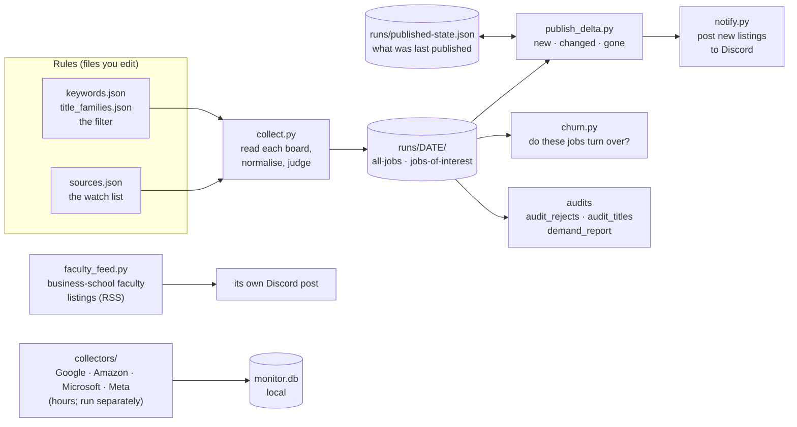

# Lectern: the board watch, in plain Python

## Executive summary

**What this is.** Lectern is a job-search tool built in the open. When it is run (there is no scheduler yet; `daily.sh` is the day's run) it reads the public job boards of the companies on a watch list, keeps the postings that look like work Professor Bear could do (teaching materials, education products, partnerships with universities), says why each was kept or thrown away, works out what is new since the last published run, and posts the new ones to a public Discord channel. This folder is its plain-Python form: scripts you can read top to bottom, with the rules kept in files you can edit. **Why you might read it.** The project's real subject is not fetching postings, it is knowing what the output is worth, so every step leaves a record you can check: the rule that fired, the words that matched, what was rejected and why, what a source that could not be read did to the count. **What it has found so far.** The first filter kept recruiters and sales support instead of teachers (five words turned out to be false friends in this industry); a company that staffs an education product team is stronger evidence than any single posting; a source that fails to load must never count as a posting that closed; and, from comparing this form with its n8n twin, the filter and the delta agree with the Python on thousands of real postings.

This folder is **not the whole project**. See "What is not in this folder" below.

## The pipeline



A day's run is `ops/daily.sh`: collect, then what is new (and post it), then churn, then the faculty feed. It never commits or pushes; that needs Professor Bear's word.

## How the folder is laid out, and why

```
lectern/
  config/    sources.json · keywords.json · title_families.json · faculty_config.json    the rules: data you edit, not code
  collect/   collect.py · faculty_feed.py · collectors/                                   everything that talks to a source
  publish/   publish_delta.py · notify.py                                                 everything that changes state or tells someone
  audit/     audit_rejects.py · audit_titles.py · demand_report.py · churn.py             read-only measurement of the filter and the market
  tests/     test_*.py                                                                    no network
  ops/       daily.sh · sync.sh                                                           running it and copying it
  notes/     ATS.md
  runs/      dated output (small files tracked; the rest ignored)
  TARGETS.md · lab-outreach/ · n8n/ · faculty-runs/ · HISTORY.md     the rest of Lectern: see below
  lectern_paths.py                                                                        where things are, in one place
```

The folders follow the pipeline, not the file type: rules in, sources read, what changed published, the filter audited. Three habits this layout teaches, because the course is about writing code that others can read and trust:

1. **Separate what you edit from what runs.** The four JSON files are the only things changed by hand when a rule changes; no script has to change.
2. **Separate reading from writing.** `collect/` only reads the outside world; `publish/` is the only place with outside effects (Discord, git); `audit/` changes nothing. When something goes wrong you know which folder to look in.
3. **Never let a script guess where its files are.** Every script asks `lectern_paths.py`, so the code does not depend on which folder it is run from, and the same files run unchanged in the other two classes' flat copies (`lectern_paths.config()` looks in `config/` and then beside itself).

| Stage | Files | What it does |
|---|---|---|
| **Rules** | `config/sources.json` · `config/keywords.json` · `config/title_families.json` · `config/faculty_config.json` | The watch list (6 boards today); the filter, with a record of every word that was cut and the count that cut it; the 20 job families the title audit uses; the 21 schools and the queries for the faculty feed |
| **Collect and judge** | `collect/collect.py` | Reads Greenhouse, Ashby and SmartRecruiters boards, turns the three formats into one, applies the filter, writes every posting with the reason it was kept or rejected |
| **Lab pages** | `collect/collectors/biolabs.py` · `config/biolabs.json` | Reads public lab directory pages (robots.txt first, honest User-Agent), scores each lab page for data-heavy biology and writes a local record; no emails decoded, no outreach drafted. Adapted from the Biojobs repository |
| **The big four** | `collect/collectors/` | Google, Amazon, Microsoft and Meta have no simple public feed; these collectors take hours and write to a local database (`monitor.db`, not tracked). Not yet part of the daily delta or the filter |
| **Faculty listings** | `collect/faculty_feed.py` | Business-school faculty roles that mention AI, from two keyword feeds, each with the rule that fired |
| **What changed** | `publish/publish_delta.py` | New, changed and gone since the last published run. A source that could not be read today never closes a posting |
| **Post** | `publish/notify.py` | Builds the Discord messages (watched companies only, most-wanted first, nothing posted twice, anything with a path or email address refused). Also `post_labs()`: great-fit lab pages for Professor Bear to look at |
| **Audit the filter** | `audit/audit_rejects.py` · `audit/audit_titles.py` · `audit/demand_report.py` | A reproducible random sample of rejects to read; the same audit by job function; companies ranked by whether they want this work done |
| **Measure** | `audit/churn.py` | Are these real jobs that turn over, or postings that sit there? Closed is not hired |
| **Operations** | `ops/daily.sh` · `ops/sync.sh` | The daily run; copying the shared files to the other two classes |
| **Tests** | `tests/test_publish_delta.py` · `test_churn.py` · `test_connector_rule.py` · `test_notify.py` · `test_run_daily.py` | Run each with `python3 tests/test_x.py`; no network |
| **Notes** | `notes/ATS.md` | Which applicant-tracking system each company uses, and an honest "unknown" where it was not verified |
| **Output** | `runs/` | Dated outputs. Tracked: the small deltas, churn reports and `published-state.json`. Ignored: full snapshots, raw payloads, ad text, logs, `monitor.db`, lab records |

**What it is pointed at.** Every company, school and research group the tool watches, what kind of thing each is, where its data lives (direct links), which script reads it and what is still missing: `TARGETS.md`.

## Shared with two other classes

The same tool is live-coded in Computational Skepticism, Branding and AI, and Prompt Engineering. **This folder is the master.** `ops/sync.sh` copies the collector, the faculty feed, `collectors/`, the delta publisher, the three audit scripts, the four JSON rule files, `ATS.md` and `lectern_paths.py` to the others, **flattening** them: those classes keep one folder, and each file lands there by its base name (`./lectern/ops/sync.sh --check` reports drift; `--only <word>` syncs one class). **Not shared, on purpose:** `publish/notify.py`, `audit/churn.py`, `ops/daily.sh`, `ops/sync.sh` and the tests, which are the instructor's operations (the posting goes to one Discord channel). Edit shared files here, never in the copies. See `../SYNC.md`.

## Run it

```bash
python3 collect/collect.py --out runs/$(date +%F)   # read the boards and write a run (about a minute)
python3 publish/publish_delta.py                     # dry run: what is new since the last published run
python3 publish/publish_delta.py --write --post      # write the delta files and post the new listings
./ops/daily.sh --no-post                             # the whole day, posting nothing (a test)
python3 tests/test_publish_delta.py                  # and the other tests/test_*.py files
```

Run these from this folder. (In the other two classes' flat copies the same scripts run as `python3 collect.py` and so on.)

## Also in this folder: everything else about Lectern

Anything about Lectern lives here or in one of its folders; the folders at the level above this one are about the assignments.

- `TARGETS.md`: every company, school and research group the tool watches, classified, with the direct link to its data, the script that reads it and what is missing.
- `lab-outreach/`: the design for the part-time research search (the lab record, the places, the funding check). `collect/collectors/biolabs.py` is its first reader.
- `n8n/`: the same pipeline as five n8n workflows, tested against this Python. The point of building it more than once is to compare:


  The n8n form has its own diagrams: each workflow draws itself, and its README says what was tested. A CrewAI form is planned (`crewai/`), not built.
- `faculty-runs/`: the faculty feed's output.
- `HISTORY.md`: the daily log of what was added here and why.

**Outside this folder, on purpose.** The profile (what the search is for) is the assignment 06 file, `../06-setup-exercise-personal-layer/search/profile.yml`; **nothing reads it**, and `config/keywords.json` is edited by hand to match it. The CV facts, the early single-company iterations (`../figma/`, `../greenhouse-watch-demo/`), the design document and `../SYNC.md` are shared with the other two classes at the class level, so they stay there.

## Known gaps

- The other two classes keep a flat folder (Branding's is a student's graded path, and it should not move mid-term), so the master's folders are flattened on the way out. `lectern_paths.py` is what lets one set of files run in both layouts.
- The big-four collectors are not in the daily delta or the filter.
- `collect/collect.py` run with no `--out` writes its files into this folder; `ops/daily.sh` passes `runs/DATE`.
- The filter has measured weak spots written into `keywords.json`; this README does not repeat them.

## Keeping this folder's record

`HISTORY.md` is the daily log of what was added here and why, the same way `../FRICTIONAL.md` logs the work. Add to it whenever something in this folder changes.
