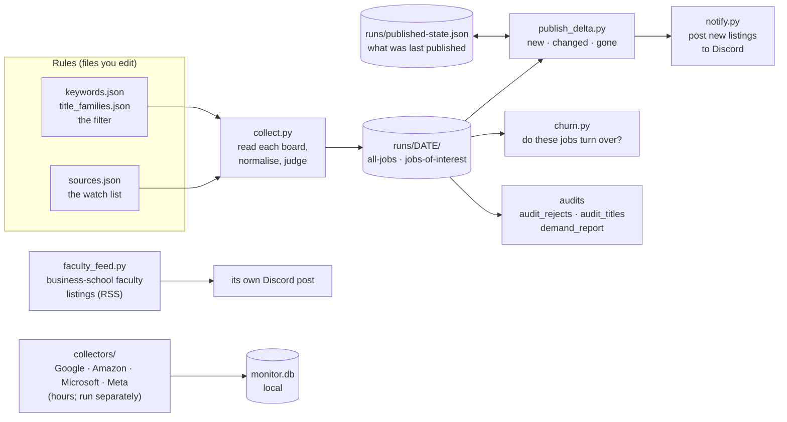
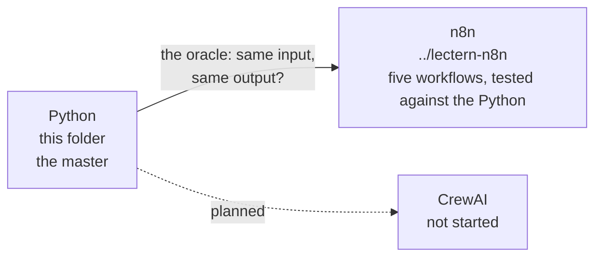

# Lectern: the board watch, in plain Python

## Executive summary

**What this is.** Lectern is a job-search tool built in the open. When it is run (there is no scheduler yet; `daily.sh` is the day's run) it reads the public job boards of the companies on a watch list, keeps the postings that look like work Professor Bear could do (teaching materials, education products, partnerships with universities), says why each was kept or thrown away, works out what is new since the last published run, and posts the new ones to a public Discord channel. This folder is its plain-Python form: scripts you can read top to bottom, with the rules kept in files you can edit. **Why you might read it.** The project's real subject is not fetching postings, it is knowing what the output is worth, so every step leaves a record you can check: the rule that fired, the words that matched, what was rejected and why, what a source that could not be read did to the count. **What it has found so far.** The first filter kept recruiters and sales support instead of teachers (five words turned out to be false friends in this industry); a company that staffs an education product team is stronger evidence than any single posting; a source that fails to load must never count as a posting that closed; and, from comparing this form with its n8n twin, the filter and the delta agree with the Python on thousands of real postings.

This folder is **not the whole project**. See "What is not in this folder" below.

## The pipeline



A day's run is `daily.sh`: collect, then what is new (and post it), then churn, then the faculty feed. It never commits or pushes; that needs Professor Bear's word.

## Where everything is

| Stage | Files | What it does |
|---|---|---|
| **Rules** (data, not code) | `sources.json` · `keywords.json` · `title_families.json` · `faculty_config.json` | The watch list (15 boards today); the filter, with a record of every word that was cut and the count that cut it; the 20 job families the title audit uses; the 21 schools and the queries for the faculty feed |
| **Collect and judge** | `collect.py` | Reads Greenhouse, Ashby and SmartRecruiters boards, turns the three formats into one, applies the filter, writes every posting with the reason it was kept or rejected |
| **Audit the filter** | `audit_rejects.py` · `audit_titles.py` · `demand_report.py` | A reproducible random sample of rejects to read; the same audit by job function instead of by posting; companies ranked by whether they want this work done |
| **What changed** | `publish_delta.py` | New, changed and gone since the last published run. A source that could not be read today never closes a posting |
| **Post** | `notify.py` | Builds the Discord messages (watched companies only, most-wanted first, nothing posted twice, anything with a path or email address refused). Also `post_labs()`: great-fit lab pages for Professor Bear to look at |
| **Measure** | `churn.py` | Are these real jobs that turn over, or postings that sit there? Closed is not hired |
| **Faculty listings** | `faculty_feed.py` | Business-school faculty roles that mention AI, from two keyword feeds, each with the rule that fired |
| **The big four** | `collectors/` | Google, Amazon, Microsoft and Meta have no simple public feed; these collectors take hours and write to a local database (`monitor.db`, not tracked). Not yet part of the daily delta |
| **Operations** | `daily.sh` · `sync.sh` | The daily run; copying the shared files to the other two classes |
| **Tests** | `test_publish_delta.py` · `test_churn.py` · `test_connector_rule.py` · `test_notify.py` · `test_run_daily.py` | Run each with `python3 test_x.py`; no network |
| **Notes** | `ATS.md` | Which applicant-tracking system each company uses, and an honest "unknown" where it was not verified |
| **Output** | `runs/` | Dated outputs. Tracked: the small deltas, churn reports and `published-state.json`. Ignored: full snapshots, raw payloads, ad text, logs, `monitor.db`, lab records |

## Shared with two other classes

The same tool is live-coded in Computational Skepticism, Branding and AI, and Prompt Engineering. **This folder is the master.** `sync.sh` copies `collect.py`, the three audit scripts, `title_families.json`, `sources.json`, `keywords.json`, `ATS.md`, `faculty_feed.py`, `faculty_config.json`, `publish_delta.py` and `collectors/` to the others (`./lectern/sync.sh --check` reports drift; `--only <word>` syncs one class). **Not shared, on purpose:** `notify.py`, `churn.py`, `daily.sh`, `sync.sh` and the tests, which are the instructor's operations (the posting goes to one Discord channel). Edit shared files here, never in the copies. See `../SYNC.md`.

## Run it

```bash
python3 collect.py --out runs/$(date +%F)   # read the boards and write a run (about a minute)
python3 publish_delta.py                     # dry run: what is new since the last published run
python3 publish_delta.py --write --post      # write the delta files and post the new listings
./daily.sh --no-post                         # the whole day, posting nothing (a test)
python3 test_publish_delta.py                # and the other test_*.py files
```

## What is not in this folder

- **The profile.** What the search is for is in `../06-setup-exercise-personal-layer/search/profile.yml`. **Nothing reads it:** `keywords.json` is edited by hand to match it. Wiring the two together is an open design question.
- **Lab outreach.** The design for the part-time research search (the lab record, the places, the funding check) is in `../lab-outreach/`. Only `post_labs()` is here.
- **The same pipeline in other forms.** The point of building it more than once is to compare:



  The n8n form has its own diagrams: each workflow draws itself, and its README says what was tested. A CrewAI form is planned, not built.

## Known gaps

- The layout is flat: code, rules, tests, notes and operations share one level. It grew day by day (see `HISTORY.md`), and moving things means re-syncing three repositories and changing paths students are told to use, so it has not been done.
- The big-four collectors are not in the daily delta.
- `collect.py` run with no `--out` writes its files into this folder; `daily.sh` passes `runs/DATE`.
- The filter has measured weak spots written into `keywords.json`; this README does not repeat them.

## Keeping this folder's record

`HISTORY.md` is the daily log of what was added here and why, the same way `../FRICTIONAL.md` logs the work. Add to it whenever something in this folder changes.
